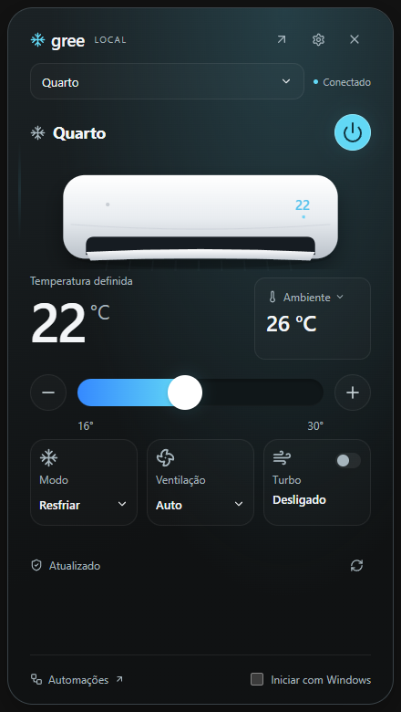

# Gree Desktop 0.3.0

Aplicativo Windows em português para controlar aparelhos Gree pela rede local, organizar grupos e criar automações. Electron + React + TypeScript, sem conta na nuvem.



## Instalar e usar

Execute `release/Gree Desktop Setup 0.3.0.exe`. O instalador permite escolher a pasta e cria um atalho na área de trabalho. O pacote não tem certificado de assinatura comercial.

1. Conecte o computador à mesma rede dos aparelhos, já configurados no GREE+.
2. Clique no ícone de floco de neve na bandeja do Windows para abrir o **controle rápido**. Selecione um aparelho ou grupo e ajuste energia, temperatura, modo e ventilação. O controle desaparece ao clicar fora ou pressionar Esc.
3. Use a seta no topo para abrir o painel completo e **Buscar aparelhos**. Se necessário, use **Adicionar por IP**.
4. No lápis de cada cartão, escolha nome e ambiente. Confirme as funções opcionais no manual ou no controle antes de habilitá-las. Turbo aparece no controle rápido quando confirmado.
5. Use **Grupos** para comandos coletivos e **Automações** para criar regras. O histórico mostra a confirmação ou a falha de cada aparelho.
6. Marque **Iniciar com Windows** no controle rápido ou configure em **Preferências**. A inicialização automática fica somente na bandeja; abrir manualmente mostra o controle rápido.

Se o ícone estiver oculto, abra a seta dos ícones da bandeja e arraste o floco de neve para a área visível. Clique direito oferece controle rápido, painel completo, automações e saída. O controle rápido usa o cartão escuro compacto inspirado na referência; o painel completo oferece temas claro, escuro e sistema.

Fechar a janela mantém o processo e as regras na bandeja. Para encerrar, use **Sair e parar automações**. O computador precisa permanecer ligado e acordado.

## Novidades da 0.3.0

- **Prioridade ao controle externo:** alterações em energia, ajuste, modo, ventilação e extras confirmados, recebidas fora dos comandos do desktop, pausam todas as automações daquele aparelho até **Retomar**. A proteção persiste ao reiniciar; em grupos, outros aparelhos continuam funcionando. O desktop não distingue controle físico de mobile e não garante detecção instantânea.
- Comandos explícitos continuam disponíveis sem remover a proteção. A pausa manual de 15 minutos é independente; remover uma não remove a outra. Retomar não executa horários perdidos nem ações acumuladas. Antes de cada comando automático, uma nova leitura revalida estado, proteção e condições.
- **Conforto:** temperaturas ambiente/definida em 1 hora, 24 horas e 7 dias; mínimo, máximo, cobertura, eventos e consulta do gráfico por teclado. A coleta começa nesta versão, com uma amostra por minuto e retenção local de 30 dias. Sensor inválido, comunicação perdida e suspensão deixam lacunas.
- **Ligado observado:** hoje e nos últimos 7 dias, com indicação dos períodos sem observação. Isso não mede compressor, consumo, kWh ou custo; não reconstrói períodos em que o computador estava desligado.
- **Manutenção:** lembrete de filtro por calendário, inicialmente desativado. Configure a última manutenção e o intervalo conforme o manual; o padrão sugerido é 30 dias. Marque como feito ou adie sete dias na página Conforto.
- **Bandeja:** resumo da casa com páginas, favoritos primeiro, próxima agenda, detalhes de proteção e vista Conforto agora ao clicar na temperatura ambiente. Abrir acompanhamento leva ao mesmo aparelho. Menus e vistas permanecem sem rolagem; o ícone não pisca.

O histórico permite filtrar controle externo e proteção, com detalhes dos campos e valores detectados. Os registros existentes da 0.2.0 continuam legíveis. Configurações anteriores são preservadas; novos registros de acompanhamento são adicionados ao mesmo SQLite.

## Novidades da 0.2.0

Design Névoa com superfícies grafite, iluminação contextual e destaque ciano. Temperatura definida e ambiente têm hierarquias próprias; o bloco Ambiente abre origem e horário da leitura. Leituras vencidas não aparecem como atuais e grupos mostram faixa e quantidade de sensores válidos.

O slider acompanha o arraste e envia um comando ao soltar. “Ajustando” e “Confirmando” distinguem prévia e confirmação; falhas restauram o estado confirmado. Mudanças reais recebem feedback localizado, respeitando movimento reduzido.

A bandeja anima abertura e saída; menus e detalhes permanecem dentro da janela e listas grandes usam páginas. Em áreas baixas, “Modo e ventilação” abre uma vista interna sem rolagem. Preferências e resultados usam toasts temporários, com pausa ao passar o mouse ou focar.

Não há migração do banco nem alteração das regras de automação. Consulte a validação para os limites do teste de atualização.

## Regras

- Gatilhos: agenda semanal, data/hora única, temperatura ambiente, mudança de energia/modo e tempo ligado observado.
- Condições: todas ou qualquer; temperatura ambiente, energia, modo, temperatura definida, ventilação ou minutos ligado.
- Ações: energia, temperatura, modo, ventilação e funções opcionais confirmadas. Em grupos, um recurso incompatível é omitido e o resultado parcial fica explícito.
- Gatilhos de temperatura, estado e duração são avaliados individualmente em cada membro. Condições também usam o estado desse membro.
- Sensor `TemSen` é convertido para Celsius com o deslocamento de 40 do protocolo. Valores ausentes ou fora da faixa plausível não são usados. Temperatura definida não substitui medição ambiente.
- Temperatura dispara na entrada da faixa e rearma após cruzar o limite de histerese (padrão 1 °C). Intervalo mínimo padrão: cinco minutos. Eventos impedidos por pausa, condições ou intervalo não são enfileirados para depois.
- O teste manual executa as ações reais sem verificar gatilhos e condições; a interface pede confirmação antes do envio.
- Comandos manuais, inclusive testes, pausam ações automáticas por 15 minutos. **Retomar** remove essa pausa.
- Regras simultâneas que alteram o mesmo campo do mesmo aparelho têm prioridade pela ordem crescente do identificador. A regra conflitante é registrada como não executada.
- Agenda usa o fuso horário do Windows. Horários perdidos não são executados retroativamente. O histórico detalha até sete dias de agendas perdidas em uma retomada.
- Reiniciar, suspender ou perder comunicação interrompe a contagem de tempo ligado. Mudança de estado exige duas leituras válidas; o primeiro estado observado não dispara transição.

## Rede e dados

Descoberta por broadcast IPv4 UDP/7000 e cadastro por MAC; mudanças de IP preservam nome e grupos. AES-ECB e AES-GCM são negociados na vinculação. O estado é consultado a cada 15 segundos por padrão; comandos usam fila por aparelho e uma nova leitura para confirmar o resultado.

O protocolo não informa de forma confiável todas as capacidades físicas. Oscilação, luz, turbo, sono, silencioso e X-Fan exigem confirmação do usuário. A aceitação de aquecimento e velocidades intermediárias depende do modelo; comandos não confirmados são reportados como falha.

Se nenhum aparelho aparecer, confira a interface/rede, a permissão do Firewall do Windows para o aplicativo na rede privada e o isolamento de clientes Wi-Fi. Redes convidadas e VLANs podem impedir broadcast ou comunicação UDP; IP manual não contorna falta de conectividade.

Dados ficam em `%APPDATA%/gree-desktop/gree.sqlite` durante o desenvolvimento; o nome da pasta pode seguir o nome do aplicativo no pacote. Consulte `app.getPath('userData')` no Electron para o caminho efetivo. As chaves são criptografadas por `safeStorage` do Electron, que usa DPAPI no Windows, antes de serem gravadas. Não copie o banco entre usuários Windows esperando reutilizar as chaves. O aplicativo não oferece servidor HTTP nem expõe chaves ao renderer.

## Desenvolvimento

Requer Node.js 22 ou superior e Windows para validar o aplicativo desktop.

```powershell
npm install
npm run diagnose
npm test
npm run build
npm start
npm run package
```

`npm run diagnose -- --ip=192.168.0.67` busca diretamente um aparelho. `--verify-command` reaplica a temperatura existente e confirma a leitura; sem essa opção, não envia comando de controle. O diagnóstico não grava chaves e salva o relatório em `diagnostics/latest.json` (ignorado pelo Git).

`scripts/electron-smoke.cjs` verifica o Electron em um perfil isolado, lê os aparelhos reais, testa DPAPI, cria um grupo e uma regra **desabilitada**, captura telas e verifica fechamento para bandeja. Não controla os aparelhos. Execute com `node_modules/electron/dist/electron.exe scripts/electron-smoke.cjs --background`; relatórios ficam em `.cache/qa`.

## Interfaces e organização

- `src/shared/types.ts`: contrato TypeScript do IPC. O preload publica apenas métodos específicos e o processo principal valida origem e dados.
- Processo principal: transporte UDP, SQLite, proteção das chaves, fila de comandos, avaliação de regras e integração com bandeja/inicialização.
- Renderer: painel, grupos, editor visual, histórico, conforto e preferências. Sem Node.js, com isolamento de contexto, sandbox e política de conteúdo local.
- SQLite guarda aparelhos, grupos, regras, preferências, chaves protegidas, cursores de execução e até 1.000 registros de histórico; a interface exibe os 300 mais recentes.

Detalhes da validação física e das limitações de teste estão em [VALIDATION.md](VALIDATION.md).

Referência do protocolo: [gree-remote](https://github.com/tomikaa87/gree-remote). A implementação deste projeto foi escrita a partir dos detalhes do protocolo.
